  

  
  

### Привет, я Виталий 👋

Создаю сайты с использованием ИИ и развиваюсь в **QA**. Мне интересно не только то, как выглядит интерфейс, но и что происходит после нажатия кнопки.

🔭 **В фокусе:** понятные интерфейсы, пользовательские сценарии и логика веб-приложений.  
🧪 **Изучаю и практикую:** тест-дизайн, API в Postman и SQL.  
🛠️ **Подход:** разобраться в задаче → собрать решение → проверить детали.

---

### Из идеи — в работающий интерфейс

| Проект | Что внутри |
| :--- | :--- |
| **[Персональное портфолио ↗](https://vkuzov.github.io/vitaly-kutuzov-portfolio/)** | React · TypeScript · Vite. Кейсы, интерактивная QA-демонстрация, адаптивная компоновка и анимации. |
| **[Кейс Starfood ↗](https://vkuzov.github.io/vitaly-kutuzov-portfolio/projects/starfood/)** | Разбор пользовательских сценариев, логики корзины и условий доставки. |

<b>🧪 Открыть QA-досье</b>

 

- **Тест-дизайн:** классы эквивалентности, граничные значения, попарное тестирование.
- **Документация:** чек-листы, тест-кейсы и баг-репорты.
- **Интерфейсы:** состояния, адаптивность и пользовательские сценарии.
- **Практический пример:** [проверка порога бесплатной доставки на 599 / 600 / 601 ₽](https://vkuzov.github.io/vitaly-kutuzov-portfolio/projects/starfood/#qa-materials).

Продолжаю учиться и показываю ход мысли на собственных проектах.

<b>⚙️ Что мне нравится в разработке</b>

 

Превращать идею в структуру страниц, собирать интерфейсы с помощью ИИ и разбираться в деталях: что увидит пользователь, какие состояния возможны и где может сломаться логика.

---

  <b>Есть идея сайта или предложение по QA?</b>  
  <a href="https://t.me/Raziel_No_Flag">Обсудим в Telegram</a> · <a href="https://vkuzov.github.io/vitaly-kutuzov-portfolio/">Посмотреть мои работы</a>

  

