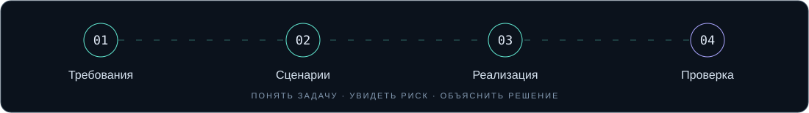

  

  <a href="https://vkuzov.github.io/vitaly-kutuzov-portfolio/"><b>ПОРТФОЛИО ↗</b></a> &nbsp; / &nbsp;
  <a href="https://vkuzov.github.io/vitaly-kutuzov-portfolio/projects/starfood/"><b>ПРОЕКТ И QA-КЕЙС ↗</b></a> &nbsp; / &nbsp;
  <a href="https://t.me/Raziel_No_Flag"><b>СВЯЗАТЬСЯ ↗</b></a>

## Интерфейс — это обещание. Логика должна его выполнять.

Я **Виталий Кутузов**. Создаю сайты с помощью ИИ, развиваюсь в QA и опираюсь на опыт технической поддержки 1С. Соединяю взгляд пользователя, анализ требований и внимание к тому, что происходит внутри приложения.

**Мой фокус — старт карьеры в QA и задачи на стыке веб-интерфейсов и тестирования.** В проектах показываю реализацию, логику решений и материалы, которые можно изучить самостоятельно.

<table>
<tr>
<td width="33%" valign="top">

### 01 / Разобраться
Раскладываю задачу на пользовательские сценарии, состояния и ожидаемый результат.

</td>
<td width="33%" valign="top">

### 02 / Реализовать
Создаю и дорабатываю сайты с ИИ: от структуры страниц до логики взаимодействия.

</td>
<td width="33%" valign="top">

### 03 / Проверить
Исследую границы, условия и ошибки. Объясняю, где поведение расходится с ожиданиями.

</td>
</tr>
</table>

## Проекты, за которыми есть содержание

### Starfood · сайт кафе и доставки еды

**Самостоятельная разработка с использованием ИИ.** Пользовательский путь от выбора блюда до оформления заказа: меню, корзина, доставка, скидки и личный кабинет.

| Область | Что проработано |
| :--- | :--- |
| **Пользовательские сценарии** | Выбор доступных блюд, изменение корзины, оформление заказа, адреса и история заказов. |
| **Бизнес-логика** | Стоимость заказа, пороги бесплатной доставки, зоны и скидки. |
| **Устройство проекта** | React и TypeScript, состояние корзины, отдельные модули цен и доставки, PHP API. |
| **QA-разбор** | Граничные значения, анализ проверок корзины и расчётов; различие между исполнением логики и проверками исходников. |

[**Изучить кейс и скриншоты →**](https://vkuzov.github.io/vitaly-kutuzov-portfolio/projects/starfood/) &nbsp; [**Открыть QA-материалы →**](https://vkuzov.github.io/vitaly-kutuzov-portfolio/materials/starfood-qa.md)

### Персональное портфолио · интерактивная презентация работ

React · TypeScript · Vite · GitHub Pages

Кейсы с архитектурой и материалами, интерактивная демонстрация ошибки на границе бесплатной доставки, адаптивная компоновка и анимации с поддержкой уменьшения движения.

[**Посмотреть сайт →**](https://vkuzov.github.io/vitaly-kutuzov-portfolio/) &nbsp; [**Изучить публичный код →**](https://github.com/vkuzov/vitaly-kutuzov-portfolio)

## Как я думаю о качестве

**Правило:** бесплатная доставка от 600 ₽.  
**Вопрос:** что произойдёт ровно на пороге, если `>=` случайно заменить на `>`?

| Сумма заказа | Ожидаемая доставка | Почему проверяю |
| :--- | :--- | :--- |
| 599 ₽ | 150 ₽ | Ближайшее значение ниже границы |
| **600 ₽** | **0 ₽** | **Сама граница — здесь проявится ошибка** |
| 601 ₽ | 0 ₽ | Ближайшее значение выше границы |

Это учебный пример из портфолио: в нём можно включить ошибку и сравнить результаты. Так я показываю ход мысли — от требования к проверяемому сценарию.

[**Попробовать демонстрацию →**](https://vkuzov.github.io/vitaly-kutuzov-portfolio/projects/starfood/)

  

## Компетенции и направление роста

| Направление | Практика и инструменты |
| :--- | :--- |
| **Тестирование** | Ручное тестирование веб-интерфейсов, пользовательские сценарии, адаптивность и совместимость браузеров. |
| **Тест-дизайн** | Классы эквивалентности, граничные значения, попарное тестирование. |
| **Документация** | Чек-листы, тест-кейсы, баг-репорты, описание ожидаемого и фактического поведения. |
| **API и данные** | Изучаю и практикую Postman и SQL. |
| **Веб-разработка** | Создание сайтов с ИИ, постановка задач, оценка результата по требованиям. В проектах — React и TypeScript. |
| **Техническая поддержка** | Диагностика пользовательских проблем в 1С, понятные объяснения, передача задач профильным специалистам. |

<b>Больше о моём подходе к работе</b>

- **Анализ:** разбираюсь в причине проблемы, уточняю условия её появления.
- **Коммуникация:** объясняю технические вопросы понятным языком.
- **Взаимодействие:** работаю со сложными обращениями, помогаю коллегам и передаю контекст задачи.
- **Обучение:** изучаю QA на Skillbox и связываю обучение с собственными проектами.

---

### Давайте обсудим задачи вашей команды

Интересны **возможности для начинающего QA**, работа с пользовательскими сценариями и развитие веб-проектов с ИИ. Готов обсудить свои решения, показать материалы и разобрать практическую задачу.

[**Написать в Telegram →**](https://t.me/Raziel_No_Flag) &nbsp; · &nbsp; [**raskolnikofsibir@gmail.com**](mailto:raskolnikofsibir@gmail.com) &nbsp; · &nbsp; [**Портфолио →**](https://vkuzov.github.io/vitaly-kutuzov-portfolio/)
